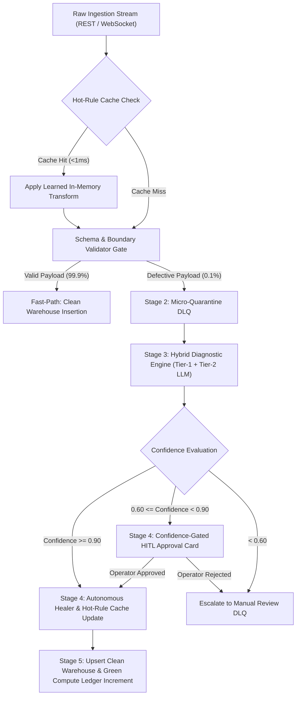

# FluxHeal (AuraFlow) — Functional Requirements Document (FRD)

> **Document Version:** v1.0 — Engineering Execution Specification  
> **Product Name:** FluxHeal (AuraFlow) — Autonomous Self-Healing ETL/ELT Data Pipeline  
> **Target Release:** Clean-Tech Hackathon 2026 MVP & Enterprise NOC/ESG Production Roadmap  
> **Domain:** Clean-Tech Data Infrastructure / Green Data Engineering / Industrial IoT & ESG Analytics  

---

## 1. Product Overview & Purpose

FluxHeal (AuraFlow) is an autonomous, zero-downtime data engineering platform that detects, isolates, diagnoses, and repairs broken ETL (Extract-Transform-Load) and ELT (Extract-Load-Transform) data pipelines in real time. Designed specifically for high-velocity, mission-critical clean-tech telemetry—such as solar and wind power farms, agricultural soil/weather sensors, EV smart-charging networks, and corporate Scope 1/2/3 carbon accounting—FluxHeal eliminates pipeline downtime while curbing the massive carbon emissions caused by redundant historical data backfills.

### 1.1 Core Problems Addressed
1. **Pipeline Brittleness:** Minor schema changes (e.g., IoT firmware renaming `power_kw` to `active_pwr_kw`), sensor glitches (`-9999°C`), or format shifts (`"64.8 kW"`) crash conventional pipelines, causing total operational blindness.
2. **Dirty Cloud Compute Waste:** Traditional pipelines fail entirely on single errors, requiring data engineers to manually patch code and re-process multi-million row historical batches. This consumes unnecessary vCPU hours and swells data center Scope 3 emissions.

---

## 2. Target Personas & User Journeys

```
┌────────────────────────────────────────────────────────────────────────────────────────┐
│                                TARGET USER PERSONAS                                    │
├─────────────────────┬───────────────────────────────┬──────────────────────────────────┤
│ Persona             │ Role & Environment            │ Primary Operational Goals        │
├─────────────────────┼───────────────────────────────┼──────────────────────────────────┤
│ 1. IoT & Data       │ Manages 1,000+ solar, wind,   │ Zero 2 AM alerts; zero-downtime  │
│    Engineer         │ or agricultural sensor feeds. │ ingestion; fast automated schema │
│    (Primary Builder)│ Works in NestJS & PostgreSQL. │ drift and outlier healing.       │
├─────────────────────┼───────────────────────────────┼──────────────────────────────────┤
│ 2. ESG & Carbon     │ Aggregates grid emissions,    │ Clean, normalized datasets;      │
│    Analyst          │ billing data, and factory     │ 100% auditable lineage metadata; │
│    (Business User)  │ sensor telemetry for audits.  │ unblocked nightly SQL reports.   │
├─────────────────────┼───────────────────────────────┼──────────────────────────────────┤
│ 3. Hackathon Judge/ │ Evaluates technical depth,    │ Visceral 60fps topology stream;  │
│    Tech Executive   │ architecture viability, and   │ 1-click chaos fault injection;   │
│    (Evaluator)      │ measurable clean-tech impact. │ measurable carbon ROI.           │
└─────────────────────┴───────────────────────────────┴──────────────────────────────────┘
```

---

## 3. Product Goals & Measurable KPIs

| KPI Metric Category | Specific Indicator | Traditional Pipeline Baseline | FluxHeal Target |
| :--- | :--- | :--- | :--- |
| **Reliability** | Pipeline Uptime During Faults | Drops to 0% (Halts pipeline) | **99.99%** (Zero-Downtime Micro-Quarantine) |
| **Speed (MTTR)** | Mean Time to Resolution | 2 – 6 Hours (Manual human fix) | **< 1.5s** (AI Diagnosis) / **< 1ms** (Hot-Rule Cache) |
| **Performance** | Fast-Path Ingestion Overhead | N/A | **< 2ms** latency per payload at NestJS layer |
| **Sustainability** | Avoided Backfill Rows | 0% (100% of batch re-run) | **99.9%+** of healthy batch records unblocked |
| **Healing Accuracy** | Autonomous Healing Precision | N/A | **≥ 95%** deterministic & LLM accuracy (with HITL fallback) |

---

## 4. Detailed Functional Epics & Specifications (MoSCoW)



### Epic 1: High-Throughput Ingestion & Hot-Rule Cache (NestJS IngestionModule)

#### FR-1.1: Multi-Source Stream & Batch Ingestion
- **Priority:** Must Have
- **Requirement:** System must expose REST endpoints (`POST /api/v1/ingest/:connector`) and WebSocket stream gateways (`/stream`) capable of ingesting single JSON telemetry objects or bulk JSON arrays up to 10,000 records per payload.
- **Inputs:** `connector_id` (string), `payload` (JSON object or array of objects).
- **Validation:** Ingestion layer confirms JSON syntax and payload size limits (<10MB) before stream processing.

#### FR-1.2: Sub-Millisecond Hot-Rule Cache Check
- **Priority:** Must Have
- **Requirement:** Before executing schema validation, the system must compute a lightweight structural signature hash (`source_signature = SHA256(connector + sorted_keys + data_types)`). It must query the in-memory `HotRuleCacheService` (`Map<string, CompiledHealingRule>`).
- **Behavior:** If a matching rule exists, the system applies the compiled in-memory JavaScript/TypeScript transformation function in `<0.5ms` directly to the incoming packet without invoking the validator or LLM engine.

#### FR-1.3: Schema, Type & Physical Boundary Gate
- **Priority:** Must Have
- **Requirement:** In the absence of a cached rule, the payload must pass through `ValidatorService` verifying:
  - Required fields present (`device_id`, `timestamp`, `power_kw`).
  - Strict data types (`FLOAT`, `TIMESTAMPTZ`, `VARCHAR`).
  - Domain-specific clean-tech physical boundaries:
    - `temperature_c`: `-50.0` to `85.0`
    - `moisture_pct`: `0.0` to `100.0`
    - `voltage_v`: `80.0` to `500.0`
    - `frequency_hz`: `45.0` to `65.0`

---

### Epic 2: Zero-Downtime Micro-Quarantine (NestJS QuarantineModule)

#### FR-2.1: Row-Level Fault Isolation (Dead-Letter DLQ)
- **Priority:** Must Have
- **Requirement:** When a batch of $N$ records is received containing $M$ defective rows ($M < N$), the $N - M$ valid records MUST immediately be committed to `clean_telemetry_warehouse` via the Fast-Path. Only the $M$ defective records are routed to `quarantine_dlq`. Under no circumstance may the entire batch fail.

#### FR-2.2: Asynchronous Event Decoupling
- **Priority:** Must Have
- **Requirement:** Fault routing must emit `@OnEvent('pipeline.anomaly.detected')` via NestJS `EventEmitter2`. Quarantine persistence, diagnostic classification, and AI reasoning must execute asynchronously, never blocking the main ingestion stream thread.

#### FR-2.3: Contextual Snapshot Capture
- **Priority:** Should Have
- **Requirement:** For every quarantined record, store: `quarantine_id` (UUID), `connector_id`, `raw_payload` (JSONB), `error_message`, `stack_trace`, and the last 5 historical valid readings for that specific `device_id` retrieved from `TimeSeriesWindowService`.

---

### Epic 3: Dual-Mode Autonomous Healing Engine (NestJS HealerModule & EltWarehouseModule)

#### FR-3.1: Semantic Schema-Drift Resolution (ETL Mode)
- **Priority:** Must Have
- **Requirement:** When an unknown key arrives (e.g., `active_pwr_kw` instead of `power_kw`), the system executes:
  1. Levenshtein string distance calculation against expected schema columns.
  2. If ambiguity exists, invokes Tier-2 LLM semantic analysis with schema header prompt.
  3. Synthesizes a key-remapping rule and calculates confidence score.

#### FR-3.2: Time-Series Sensor Imputation (ETL Mode)
- **Priority:** Must Have
- **Requirement:** When an IoT sensor sends `null`, `NaN`, or an out-of-bounds spike (`-9999°C`), the system uses `TimeSeriesWindowService` maintaining a circular buffer of the last 20 valid readings for that `device_id`.
- **Imputation Formula:** Calculates the Exponential Moving Average (EMA) or linear interpolation:
  $$\text{EMA}_t = \alpha \times Y_t + (1 - \alpha) \times \text{EMA}_{t-1}$$
  where $\alpha = \frac{2}{N+1} = \frac{2}{21} \approx 0.0952$.
  The imputed value replaces the corrupted sensor metric.

#### FR-3.3: Format & Unit String Normalizer (ETL Mode)
- **Priority:** Must Have
- **Requirement:** Synthesizes regex extractors when numeric fields arrive as unit-contaminated strings (e.g., `"64.8 kW"` $\rightarrow$ `64.8`, `"230.5 V"` $\rightarrow$ `230.5`). Normalizes heterogeneous timestamp strings (e.g., `DD/MM/YYYY HH:mm:ss`, epoch milliseconds) to standard ISO-8601 `TIMESTAMPTZ`.

#### FR-3.4: Transactional ELT SQL Patching via PostgreSQL SAVEPOINT
- **Priority:** Must Have
- **Requirement:** For raw data loaded into `raw_staging_payloads`, when scheduled analytical transformation SQL fails:
  1. Catch PostgreSQL runtime exceptions (`42703` undefined column, `22012` division by zero, `22P02` invalid cast).
  2. Roll back to `SAVEPOINT elt_execution`.
  3. Introspect `INFORMATION_SCHEMA.COLUMNS` of the staging table.
  4. Automatically patch the SQL AST (e.g., rewrites `emissions / power_consumed` to `emissions / NULLIF(power_consumed, 0)`).
  5. Execute dry-run test under `SAVEPOINT elt_healed_retry`, and commit on success.

#### FR-3.5: Self-Learning Hot-Rule Compilation
- **Priority:** Must Have
- **Requirement:** Once a healing transformation succeeds with confidence $\ge 0.90$, compile the rule into native TypeScript/JavaScript, persist it to `healing_rules_registry`, and push it into `HotRuleCacheService`. All future matching records execute in $<1\text{ms}$ with zero LLM API calls.

---

### Epic 4: Green Compute & Carbon Accounting (NestJS GreenMetricsModule)

#### FR-4.1: Avoided Backfill & CPU Calculator
- **Priority:** Must Have
- **Requirement:** For every anomaly healed in-flight, calculate the number of healthy batch/table rows spared from re-processing ($R_{\text{saved}} = R_{\text{batch}} - R_{\text{quarantined}}$). Convert saved computation into avoided CPU-milliseconds and energy saved:
  $$E_{\text{Wh}} = \left(\frac{T_{\text{saved\_cpu\_ms}}}{3,600,000}\right) \times P_{\text{vCPU\_watts}} \times \text{PUE}$$
  where $P_{\text{vCPU\_watts}} = 12\text{W}$ and $\text{PUE} = 1.2$.

#### FR-4.2: Real-Time Carbon Savings Ledger ($g\text{CO}_2e$)
- **Priority:** Must Have
- **Requirement:** Convert saved $\text{kWh}$ into prevented carbon emissions using regional grid carbon intensity ($I_{\text{grid}} \approx 475\text{ gCO}_2/\text{kWh}$):
  $$C_{g\text{CO}_2e} = \left(\frac{E_{\text{Wh}}}{1000}\right) \times I_{\text{grid}}$$
  Log every saving event in `green_compute_ledger` and stream real-time updates over WebSocket to the UI top bar.

#### FR-4.3: Carbon-Aware ELT Batch Deferral
- **Priority:** Could Have
- **Requirement:** Provide an operational toggle in UI to defer non-urgent heavy warehouse aggregations to low-carbon grid windows (peaking solar/wind production).

---

### Epic 5: Governance, Lineage & Human-in-the-Loop (HITL)

#### FR-5.1: Immutable `_healed_meta` Lineage Tagging
- **Priority:** Must Have
- **Requirement:** Every healed record inserted into `clean_telemetry_warehouse` MUST set `is_healed = TRUE` and attach a tamper-evident JSONB column `_healed_meta`:
  ```json
  {
    "is_healed": true,
    "anomalies_fixed": ["SCHEMA_DRIFT", "UNIT_STRING_STRIP"],
    "rule_id": "9a8f2c01-7b82-4c22-b582-771ef82a0b12",
    "raw_value": { "output_kilowatts": "64.8 kW" },
    "confidence": 0.984,
    "healed_at": "2026-11-03T01:14:00Z",
    "compute_saved_ms": 1420
  }
  ```

#### FR-5.2: Confidence-Gated HITL Approval Flow
- **Priority:** Must Have
- **Requirement:**
  - $\ge 0.90$ Confidence: Auto-deploy and cache.
  - $0.60 \le \text{Confidence} < 0.90$: Retain in status `PENDING_HITL` and trigger an interactive approval card in the UI.
  - $< 0.60$: Send to manual quarantine review.

#### FR-5.3: One-Click Rule Rollback & Blast Radius Recovery
- **Priority:** Should Have
- **Requirement:** Provide an operational endpoint (`POST /api/v1/rules/:id/revert`) and UI action that:
  1. Disables the rule in `HotRuleCacheService` immediately.
  2. Marks `healing_rules_registry.is_active = FALSE`.
  3. Restores affected warehouse rows to their original `_healed_meta.raw_value`.

---

### Epic 6: Interactive Mission Control UI & Chaos Simulator

#### FR-6.1: 60 FPS Node Topology Canvas
- **Priority:** Must Have
- **Requirement:** Render the 5-stage pipeline loop (Source $\rightarrow$ Validator $\rightarrow$ Quarantine $\rightarrow$ Healer $\rightarrow$ Warehouse) with color-coded particle streams driven by real-time WebSocket events.

#### FR-6.2: Chaos Fault Injector Dock
- **Priority:** Must Have
- **Requirement:** Provide 4 dedicated one-click simulation buttons on the dashboard:
  1. `[⚡ Schema Drift]`: Renames key to `active_power_kw`.
  2. `[🌡️ Sensor -9999 Spike]`: Sends `-9999°C` temperature.
  3. `[🔤 Dirty Units]`: Sends `"64.8 kW"` string.
  4. `[💥 Break ELT SQL]`: Triggers `division_by_zero` SQL query.

#### FR-6.3: Live Side-by-Side Diff Inspector
- **Priority:** Must Have
- **Requirement:** Display the broken raw JSON payload in red syntax beside the sanitized healed payload in green syntax with rule details and confidence rating in real time.

---

## 5. Non-Functional Requirements (NFRs)

### 5.1 Latency & Performance
- In-memory hot-rule cached transformations MUST execute in $<1\text{ms}$.
- Schema and boundary validation gate MUST complete in $<2\text{ms}$ per packet.
- WebSocket UI state broadcasts MUST render within $<50\text{ms}$ of backend state transitions.

### 5.2 Zero Data Loss Guarantee
- Every incoming record MUST deterministically land in either `clean_telemetry_warehouse` or `quarantine_dlq`. No payload may be dropped silently.
- Storage engine uses PostgreSQL with ACID transactional durability.

### 5.3 LLM Cost & Privacy Guardrails
- The AI Healer MUST NEVER send bulk dataset rows to third-party LLMs. Only schema headers, database error codes, and a single sanitized sample record may be sent.
- Once a rule is cached, subsequent LLM API calls for that structural signature drop to zero.

### 5.4 Resilience & Offline Fallback
- If the external LLM API is unavailable or times out (>3000ms), Tier-1 deterministic heuristics (Regex unit stripper, EMA moving average, Levenshtein column mapper) MUST continue unhindered.

---

## 6. Acceptance Criteria & End-to-End Test Scenarios (Gherkin)

```gherkin
Feature: Autonomous Self-Healing Pipeline Lifecycle

  Scenario: Autonomous Schema Drift Healing and Hot Caching
    Given connector "solar-grid-01" expects schema { device_id, timestamp, power_kw }
    When user triggers Chaos Fault [Inject Schema Drift] with payload { device_id: "INV-12", timestamp: "2026-11-03T01:00:00Z", active_power_kw: 48.5 }
    Then ValidatorService flags missing required field "power_kw" and isolates record into "quarantine_dlq"
    And healthy streaming records from other inverters continue flowing without interruption
    And HealerService computes Levenshtein and semantic match from "active_power_kw" to "power_kw" with confidence >= 0.90
    And HealerService writes the healed record to "clean_telemetry_warehouse" with "_healed_meta.is_healed = true"
    And HotRuleCacheService registers the compiled transform under the payload signature
    And subsequent incoming payloads with "active_power_kw" bypass Quarantine and write to Warehouse in < 1ms.

  Scenario: Sensor Outlier EMA Imputation
    Given sensor "AGRI-MOIST-42" has 20 previous readings with mean temperature 36.5°C
    When user triggers Chaos Fault [Sensor -9999 Spike] sending temperature_c = -9999
    Then ValidatorService detects physical boundary violation (-9999 < -50)
    And HealerService imputes temperature using Exponential Moving Average (~36.5°C)
    And the clean record is saved with "_healed_meta.raw_value.temperature_c = -9999" and "healing_method = EMA_IMPUTATION".

  Scenario: Transactional ELT SQL Savepoint Recovery
    Given a batch of 50,000 smart-meter staging records where 1 record has power_consumed = 0
    When user triggers [Break ELT SQL] executing "SELECT emissions / power_consumed FROM raw_staging_payloads"
    Then PostgreSQL raises SQLSTATE 22012 (division_by_zero)
    And EltWarehouseService executes "ROLLBACK TO SAVEPOINT elt_execution"
    And EltWarehouseService rewrites query AST to "emissions / NULLIF(power_consumed, 0)"
    And re-executes inside "SAVEPOINT elt_healed_retry" and commits transaction
    And increments avoided backfill rows counter by 49,999 in "green_compute_ledger".
```
