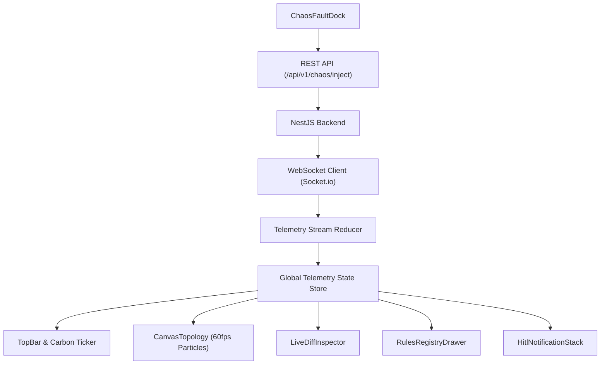

# FluxHeal (AuraFlow) — UI/UX Specification & Front-End Functional Specification Document (FSD)

> **Document Version:** v1.0 — Front-End Design & Engineering Blueprint  
> **Tech Stack:** React 19 + TypeScript + Tailwind CSS + HTML5 Canvas / React Flow + Socket.io + Recharts + Lucide Icons  
> **Target Displays:** Responsive across Desktop 4K/2K NOC walls, Laptop 1080p, Tablet 768p, and Mobile 375p  

---

## 1. Design Philosophy & Selected Design Style

### 1.1 Chosen Design Style: Clean-Tech Cyber-Minimalism (Dark Ops)
Clean-Tech infrastructure tools are often either dry enterprise spreadsheets or superficial marketing sites. FluxHeal is engineered as a **mission-critical NOC (Network Operations Center) telemetry control deck**.
- **Aesthetic Principles:**
  - **Obsidian Dark Canvas:** Minimizes eye fatigue for operators monitoring continuous data streams over 8-hour shifts.
  - **Glassmorphism & Crisp Precision:** Frosted glass cards (`backdrop-blur-md bg-slate-surface/70`) with subtle neon border treatments.
  - **Luminous Energy Accents:** Emerald and Cyan accents provide instant, pre-attentive recognition of healthy stream throughput vs. diagnostic activities.
  - **Information Density:** High information density without visual noise. Every pixel conveys operational or environmental status.

### 1.2 Chosen Design Patterns:
1. **F-Pattern Master Dashboard:** The operator's eye scans the top Carbon & Health Ribbon first, moves to the high-velocity Node Topology Canvas in the center, and navigates down to the Live Diff Inspector and Chaos Control Dock.
2. **Split-Screen Diff Comparison:** Direct juxtaposed visual comparison of defective raw payloads (quarantine) vs. synthesized healed payloads.
3. **Persistent Bottom Chaos Control Dock:** Immediate tactile interaction encouraging evaluators and operators to inject anomalies without navigating away.
4. **Confidence-Gated Human-in-the-Loop Toast/Sheets:** Non-blocking approvals ensuring operators stay in flow.

---

## 2. Strict 4-Color Theme System

To ensure mathematical visual discipline and zero color noise, the system enforces a strict palette of **exactly 4 base color tokens**. All visual elements, card layers, glowing borders, and status feedback derive from these tokens via controlled alpha opacities.

```
┌────────────────────────────────────────────────────────────────────────┐
│                        STRICT 4-COLOR THEME                            │
├─────────────────────┬───────────┬──────────────────────────────────────┤
│ Token Name          │ Hex Value │ Core Semantic Function               │
├─────────────────────┼───────────┼──────────────────────────────────────┤
│ 1. Obsidian Night   │ #0B0F19   │ Base Viewport Canvas & Depth         │
│ 2. Slate Surface    │ #1E293B   │ Container Surfaces, Borders, Chrome  │
│ 3. Emerald Flux     │ #10B981   │ Velocity, Fast-Path, Healed, Eco ROI │
│ 4. Cyan Intelligence│ #06B6D4   │ AI Diagnostic Engine, Live Packets   │
└─────────────────────┴───────────┴──────────────────────────────────────┘
```

### 2.1 Color Token Mapping & Opacity Matrix

| Token | Hex | Opacity Level | Tailwind Equivalent | Use Case |
| :--- | :--- | :--- | :--- | :--- |
| **Obsidian Night** | `#0B0F19` | 100% | `bg-[#0B0F19]` | Root background canvas |
| | | 90% | `bg-[#0B0F19]/90 backdrop-blur-lg` | Sticky header and modal overlays |
| | | 50% | `bg-[#0B0F19]/50` | Monospace code block interiors |
| **Slate Surface** | `#1E293B` | 100% | `bg-[#1E293B]` | Elevated buttons, tooltips |
| | | 70% | `bg-[#1E293B]/70` | Primary dashboard card containers |
| | | 40% | `border-[#1E293B]/40` | Subtle container grid dividers |
| **Emerald Flux** | `#10B981` | 100% | `text-[#10B981]`, `bg-[#10B981]` | Primary CTA, healed status, carbon ticker |
| | | 30% | `border-[#10B981]/30` | Healed card borders, active filters |
| | | 12% | `bg-[#10B981]/12` | Healed diff row highlight background |
| **Cyan Intelligence**| `#06B6D4` | 100% | `text-[#06B6D4]`, `bg-[#06B6D4]` | Active packet paths, AI status beacon |
| | | 35% | `border-[#06B6D4]/35` | Focused inputs, AI active container border |
| | | 15% | `bg-[#06B6D4]/15` | Diagnostic badge background |

### 2.2 Text Contrast & Readability Hierarchy
Text values are tinted slate shades that deliver certified WCAG AAA contrast ($\ge 7:1$) against `#0B0F19`:
- **Primary Text:** `#F8FAFC` (Slate-50, 97% brightness) — Headers, key metric values, table titles.
- **Secondary Text:** `#94A3B8` (Slate-400, 65% brightness) — Labels, descriptions, table column headers.
- **Muted Text:** `#64748B` (Slate-500, 45% brightness) — Timestamps, rule signatures, disabled hints.

---

## 3. Typography Architecture & Telemetry Formatting

### 3.1 Font Pairing System
```
┌─────────────────────────────────┬──────────────────────────────────────────┐
│ Primary Interface Font          │ Telemetry, Code & Metric Font            │
├─────────────────────────────────┼──────────────────────────────────────────┤
│ Inter                           │ JetBrains Mono                           │
│ - Geometric clarity & legibility│ - Monospaced with programming ligatures  │
│ - Zero aesthetic distortion     │ - Tabular figures prevent layout jitter  │
│ - Used for headings, body,      │ - Used for JSON streams, SQL AST diffs,  │
│   buttons, modal dialogs        │   timestamps, coordinates, and metrics   │
└─────────────────────────────────┴──────────────────────────────────────────┘
```

### 3.2 Modular Scale Specifications
```css
/* Typography Scale Tokens */
--text-hero:     2.000rem; /* 32px | Line-Height: 36px | Font: JetBrains Mono 700 (Carbon Ticker) */
--text-h1:       1.375rem; /* 22px | Line-Height: 28px | Font: Inter 600 (Page Titles) */
--text-h2:       1.000rem; /* 16px | Line-Height: 22px | Font: Inter 600 (Card Titles) */
--text-h3:       0.875rem; /* 14px | Line-Height: 20px | Font: Inter 500 (Subheads) */
--text-body:     0.8125rem;/* 13px | Line-Height: 18px | Font: Inter 400 (Body Descriptions) */
--text-mono:     0.750rem; /* 12px | Line-Height: 16px | Font: JetBrains Mono 400 (JSON/SQL Diffs) */
--text-micro:    0.6875rem;/* 11px | Line-Height: 14px | Font: JetBrains Mono 600 UPPER (Badges) */
```

### 3.3 Strict Formatting Standards
1. **Live Numerical Ticker:** All streaming counters MUST declare `font-mono tabular-nums tracking-tight` to avoid layout jitter during high-frequency WebSocket updates.
2. **Lineage Tags:** Tag pills display in `text-[11px] font-mono tracking-wider uppercase font-semibold`.
3. **Payload Inspection:** Syntax highlighted code blocks use JetBrains Mono at 12px with a 1.4 line-height ratio.

---

## 4. Navigations & Shell Architecture

### 4.1 Global Shell Wireframe
```
┌────────────────────────────────────────────────────────────────────────────────────────┐
│ TOP STATUS BAR: Logo | Active Connector | Live Carbon Ribbon | Autonomy Slider | Health│
├──────┬─────────────────────────────────────────────────────────────────────────────────┤
│ L    │ MAIN VIEWPORT CONTAINER                                                         │
│ E    │ ┌─────────────────────────────────────────────────────────────────────────────┐ │
│ F    │ │ SECTION 1: 5-Stage Autonomous Loop Topology Canvas (60 FPS Animated Canvas) │ │
│ T    │ └─────────────────────────────────────────────────────────────────────────────┘ │
│      │ ┌──────────────────────────────────────┬──────────────────────────────────────┐ │
│ N    │ │ SECTION 2A: Live Side-by-Side Diff   │ SECTION 2B: Real-Time Stream Ledger  │ │
│ A    │ │ - Defective Raw Payload (Quarantine) │ - Avoided Compute & gCO2e Ledger     │ │
│ V    │ │ - Synthesized Healed Record / SQL    │ - Live Ingestion Packet Stream       │ │
│      │ └──────────────────────────────────────┴──────────────────────────────────────┘ │
│ R    ├─────────────────────────────────────────────────────────────────────────────────┤
│ A    │ BOTTOM DOCK: Chaos Fault Injector & Manual Stream Controls                      │
│ I    │ [⚡ Schema Drift]  [🌡️ Outlier Spike]  [🔤 Dirty Units]  [💥 Break ELT SQL]     │
│ L    └─────────────────────────────────────────────────────────────────────────────────┘
└────────────────────────────────────────────────────────────────────────────────────────┘
```

### 4.2 Top Bar: The Environmental & Operational Ribbon
- **Brand Lockup:** Hexagonal clean-tech icon with an Emerald neon heartbeat pulse and product title `FluxHeal`.
- **Connector Selector:** Dropdown selector (`solar-grid-01`, `wind-turbine-cluster-4`, `agri-moisture-array`, `ev-chargers-metro`).
- **Live Carbon & Compute Ticker:**
  - *Avoided Backfill Rows:* `1,420,890 rows` (Emerald text)
  - *Saved Compute:* `18.4 CPU-Hrs` (Emerald text)
  - *Prevented Emissions:* `7,240.2 gCO2e` (Emerald text with leaf glyph)
- **Autonomy Mode Slider:** Interactive 3-way toggle:
  - `Safe (Human-in-the-Loop)` | `Balanced (≥90% Auto)` | `Aggressive (≥80% Auto)`
- **Cluster Heartbeat:** Real-time WebSocket connection ping indicator (`<1ms`).

### 4.3 Left Navigation Rail (60px Collapsed / 220px Expanded)
- `Topology Canvas` (`icon: Activity`): Real-time visual pipeline flow.
- `Quarantine DLQ` (`icon: AlertTriangle`): Dead-letter isolation queue and context viewer.
- `Healing Rules Registry` (`icon: Cpu`): Hot-rule cache explorer and 1-click rollback controls.
- `Green Compute Ledger` (`icon: Leaf`): Environmental ROI analytics and deferred ELT scheduler.
- `ELT Warehouse Staging` (`icon: Database`): Raw JSONB staging and PostgreSQL transactional savepoints.

---

## 5. Responsive Container Layouts & Breakpoint Grid

```
Breakpoints:
├── Desktop 4K & NOC Wall:   >= 1920px (Expanded 3-column telemetry layout, 480px canvas)
├── Laptop 1080p Standard:  1280px - 1919px (Standard 2-column split diff, 360px canvas)
├── Tablet Landscape:        768px - 1279px (Tabbed inspector view, 280px canvas)
└── Mobile Monitor:         < 768px (Vertical stacked card flow, bottom sheet HITL)
```

### Container Structure (Desktop 1080p Standard):
- **Outer Shell:** `h-screen w-screen bg-[#0B0F19] text-[#F8FAFC] flex flex-col overflow-hidden`
- **Main Viewport:** `flex-1 flex overflow-hidden`
- **Content Area:** `flex-1 flex flex-col p-4 gap-4 overflow-y-auto`
- **Topology Container:** `w-full h-[340px] bg-[#1E293B]/70 border border-[#1E293B] rounded-xl p-4 relative backdrop-blur-md`
- **Inspection Row:** `grid grid-cols-12 gap-4 flex-1 min-h-[360px]`
  - *Col 1-7:* Live Diff & AST Inspector (`col-span-7 bg-[#1E293B]/70 border border-[#1E293B] rounded-xl p-4`)
  - *Col 8-12:* Real-Time Event & Carbon Ledger (`col-span-5 bg-[#1E293B]/70 border border-[#1E293B] rounded-xl p-4`)

---

## 6. Front-End Functional Specification (FSD) & Core Components

### 6.1 Component 1: `CanvasTopology` (5-Stage Autonomous Loop)
- **Engine:** HTML5 2D Context on a `requestAnimationFrame` loop maintaining 60 FPS.
- **Node Entities:**
  1. `Node_Ingest`: Displays fast-path input packet rate (e.g., `1,250 pkt/s`).
  2. `Node_Quarantine`: Glows when anomalous records are isolated.
  3. `Node_Diagnostic`: Emits rotating Cyan beacon during Tier-1/Tier-2 AI reasoning.
  4. `Node_Healer`: Pulses Emerald upon successful patch synthesis.
  5. `Node_Warehouse`: Increments total clean records committed.
- **Particle System:**
  - *Valid Particles:* Small `#10B981` (Emerald) packets traveling directly from Ingestion to Warehouse along the upper fast-path arc.
  - *Anomalous Particles:* `#06B6D4` (Cyan) packets routed down into the Quarantine node, moving through Diagnostic and Healer nodes before merging back into Warehouse.

### 6.2 Component 2: `ChaosFaultDock`
- **Location:** Anchored at the bottom of the viewport.
- **Buttons:**
  1. `[⚡ Schema Drift]`: Sends `{ device_id: "INV-12", active_power_kw: 48.5 }` (unknown key).
  2. `[🌡️ Sensor -9999 Spike]`: Sends `{ device_id: "AGRI-01", temperature_c: -9999 }` (outlier).
  3. `[🔤 Dirty Units]`: Sends `{ device_id: "SOLAR-09", output_kilowatts: "64.8 kW" }` (string unit).
  4. `[💥 Break ELT SQL]`: Sends SQL execution trigger with division by zero.
- **Speed Multiplier:** Allows 1x, 5x, and 10x streaming rates for live hackathon stress-testing.

### 6.3 Component 3: `LiveDiffInspector`
- **State Props:** `activeAnomaly: QuarantineRecord | null`, `activePatch: HealerPatch | null`
- **Left Column (Raw Broken JSON):**
  - Displays original JSON payload formatted with JetBrains Mono.
  - Red-accented border tag highlighting offending field and validation error message.
- **Center Divider:**
  - Transformation Arrow `──►` with confidence score badge (`98.4% Confidence`).
  - Speed badge: `AI Synthesized in 840ms | Cached for <1ms re-use`.
- **Right Column (Healed Clean Payload):**
  - Displays sanitized JSON with emerald background highlight on patched keys.
  - Immutable `_healed_meta` audit block viewer.

### 6.4 Component 4: `ConfidenceGatedHitlModal`
- **Trigger:** Rendered when `0.60 <= confidence < 0.90`.
- **Card Contents:**
  - Source connector and anomaly diagnosis summary.
  - Proposed schema mapping or regex parser.
  - Actions: `[ 1-Click Approve & Cache Rule ]` (Emerald) vs `[ Reject & Keep in DLQ ]` (Slate).

### 6.5 Component 5: `RulesRegistryDrawer`
- **Data Table:**
  - Columns: `Signature Hash`, `Category`, `Transformation Code`, `Confidence`, `Hit Count`, `Actions`.
  - Action: `[ Revert Rule ]` triggers immediate eviction from in-memory cache and rolls back affected warehouse rows.

---

## 7. State Management Architecture



### Client-Side State Interfaces
```typescript
export interface TelemetryState {
  isConnected: boolean;
  activeConnector: string;
  autonomyThreshold: number; // 0.80, 0.90, 1.00
  metrics: {
    totalProcessed: number;
    quarantinedCount: number;
    avoidedBackfillRows: number;
    cpuHoursSaved: number;
    energyWhSaved: number;
    co2GramsSaved: number;
  };
  activeQuarantine: QuarantineRecord | null;
  activePatch: HealerPatch | null;
  hitlPendingQueue: HitlItem[];
  cachedRules: HealingRule[];
}
```
