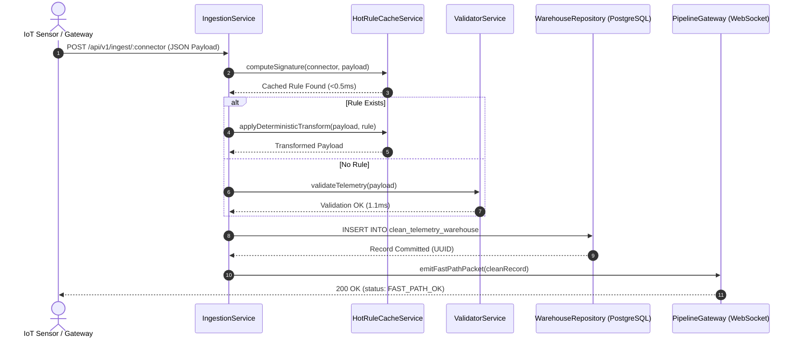
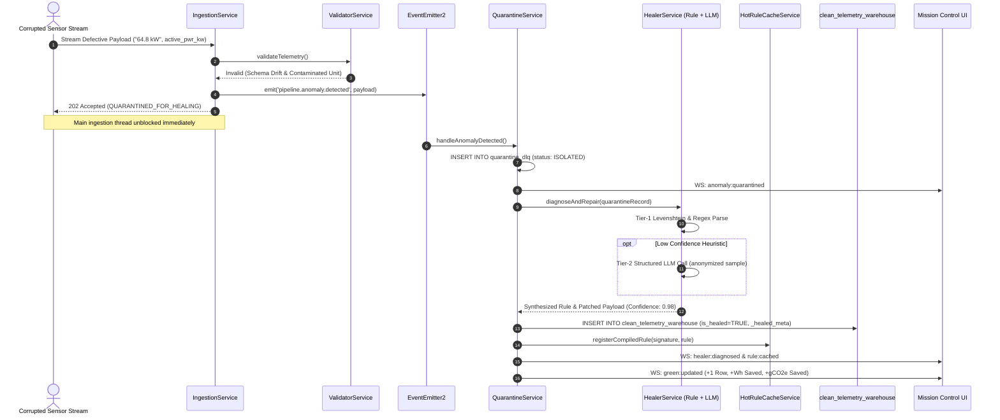
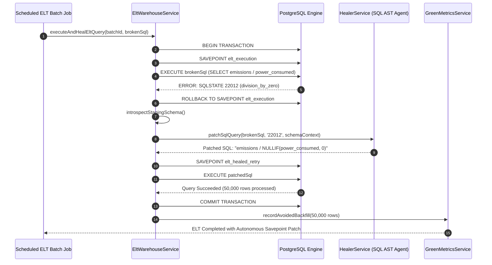

# FluxHeal (AuraFlow) — Component Architecture (CA)

> **Document Version:** v1.0 — System Engineering & Architectural Blueprint  
> **Product Architecture:** Full-Stack Reactive Micro-Engine (NestJS Monolith + React 19 Canvas UI + PostgreSQL 16)  
> **Target Release:** Clean-Tech Hackathon 2026 & Enterprise Mission Control  

---

## 1. High-Level Architectural Decomposition

FluxHeal is architected into three decoupled layers: **The High-Velocity Ingestion & Cache Layer**, **The Autonomous Healer & Storage Engine**, and **The 60 FPS Mission Control Presentation Layer**.

```
┌────────────────────────────────────────────────────────────────────────────────────────┐
│                                FLUXHEAL SYSTEM TOPOLOGY                                │
├────────────────────────────────────────────────────────────────────────────────────────┤
│                                                                                        │
│  [ IoT Gateways / APIs ] ──► [ Ingestion Service ]                                     │
│                                      │                                                 │
│                                      ▼                                                 │
│                        [ HotRuleCache (<0.5ms) ] ──(Hit)─────────────────────────┐     │
│                                      │ (Miss)                                    │     │
│                                      ▼                                           │     │
│                        [ Schema & Boundary Gate ]                                │     │
│                             │                  │                                 │     │
│              (Valid 99.9%)  │                  │ (Anomalous 0.1%)                │     │
│                             ▼                  ▼                                 │     │
│      ┌─────────────────────────────┐   ┌──────────────────────────────┐          │     │
│      │ clean_telemetry_warehouse   │   │ quarantine_dlq (Dead Letter) │          │     │
│      └─────────────────────────────┘   └──────────────┬───────────────┘          │     │
│                     ▲                                 │                          │     │
│                     │                                 ▼                          │     │
│                     │                 [ Diagnostic & AI Engine ]                 │     │
│                     │                 (Tier-1 Rules + Tier-2 LLM)                │     │
│                     │                                 │                          │     │
│                     │                                 ▼                          │     │
│                     │                 [ Dual-Mode Autonomous Healer ]            │     │
│                     │                     │                     │                │     │
│                     │ (Upsert Healed Row) │                     │ (Compile Rule) │     │
│                     └─────────────────────┘                     ▼                │     │
│                                                [ Cache to HotRuleCache ] ◄───────┘     │
│                                                                                        │
├────────────────────────────────────────────────────────────────────────────────────────┤
│  REAL-TIME WEBSOCKET TRANSPORT (Socket.io Gateway)                                     │
├────────────────────────────────────────────────────────────────────────────────────────┤
│                                                                                        │
│  [ React 19 UI ] ──► [ CanvasTopology (60fps) ] | [ LiveDiff ] | [ ChaosFaultDock ]    │
│                                                                                        │
└────────────────────────────────────────────────────────────────────────────────────────┘
```

---

## 2. End-to-End Execution Sequence Diagrams

### 2.1 Sequence A: Fast-Path Stream Ingestion (<1ms Execution)
Shows how 99.9% of telemetry flows uninterrupted with sub-millisecond overhead.



---

### 2.2 Sequence B: Dead-Letter Micro-Quarantine & Autonomous Healing Loop
Illustrates zero-downtime isolation of broken records followed by AI synthesis and hot caching.



---

### 2.3 Sequence C: Transactional ELT SQL Savepoint Patching
Details how database engine errors during batch aggregation are intercepted and corrected in-transaction.



---

## 3. Backend Module Hierarchy & Responsibilities

```
┌────────────────────────────────────────────────────────────────────────────────────────┐
│                             BACKEND NESTJS MONOLITH                                    │
├─────────────────────┬──────────────────────────────────────────────────────────────────┤
│ Module Name         │ Key Responsibilities & Component Classes                         │
├─────────────────────┼──────────────────────────────────────────────────────────────────┤
│ IngestionModule     │ - IngestionController: Handles REST /api/v1/ingest               │
│                     │ - IngestionService: Manages fast-path routing and signature hash │
│                     │ - StreamGateway: Ingests WebSocket raw frames                    │
├─────────────────────┼──────────────────────────────────────────────────────────────────┤
│ ValidatorModule     │ - ValidatorService: In-memory schema and boundary gate checks    │
│                     │ - HotRuleCacheService: Map<string, CompiledRule> execution (<1ms)│
│                     │ - TimeSeriesWindowService: In-memory circular buffer for EMA     │
├─────────────────────┼──────────────────────────────────────────────────────────────────┤
│ QuarantineModule    │ - QuarantineService: PostgreSQL DLQ persistence and recovery     │
│                     │ - AnomalyEventListener: @OnEvent handler decoupled from thread   │
│                     │ - HitlController: Approvals and reject workflows                 │
├─────────────────────┼──────────────────────────────────────────────────────────────────┤
│ HealerModule        │ - HealerService: Tier-1 heuristics + Tier-2 LLM orchestration    │
│                     │ - SchemaDriftResolver: Levenshtein + semantic key remap          │
│                     │ - UnitNormalizer: Regex string extractor and type caster         │
│                     │ - SqlAstPatcher: Rewrites broken SQL queries on Savepoint        │
├─────────────────────┼──────────────────────────────────────────────────────────────────┤
│ EltWarehouseModule  │ - EltWarehouseService: Staging table and Savepoint runner        │
│                     │ - WarehouseRepository: TypeORM / pg-node clean table manager     │
├─────────────────────┼──────────────────────────────────────────────────────────────────┤
│ GreenMetricsModule  │ - GreenMetricsService: Avoided CPU hours & gCO2e calculator      │
│                     │ - GreenLedgerRepository: Persists green_compute_ledger events    │
├─────────────────────┼──────────────────────────────────────────────────────────────────┤
│ ChaosSimulatorModule│ - ChaosSimulatorService: 4 fault scenarios generator             │
│                     │ - ChaosController: POST /api/v1/chaos/inject handler             │
├─────────────────────┼──────────────────────────────────────────────────────────────────┤
│ GatewayModule       │ - PipelineGateway: Socket.io gateway broadcasting to React UI    │
└─────────────────────┴──────────────────────────────────────────────────────────────────┘
```

---

## 4. Front-End Component Decomposition & State Tree

```
<App>
 └── <TelemetryProvider> (WebSocket Context & State Machine)
      └── <ShellLayout> (Obsidian #0B0F19 Base)
           ├── <TopStatusRibbon>
           │    ├── <BrandIndicator />
           │    ├── <ConnectorDropdown />
           │    ├── <GreenComputeRibbon /> (Avoided Rows, CPU-Hrs, gCO2e)
           │    ├── <AutonomySlider />
           │    └── <WebSocketHeartbeat />
           │
           ├── <MainWorkspaceGrid>
           │    ├── <TopologyCanvasSection>
           │    │    ├── <HTML5NodeTopologyCanvas /> (60 FPS Animated Particles)
           │    │    └── <CanvasOverlayMetrics />
           │    │
           │    ├── <InspectionSplitRow>
           │    │    ├── <LiveDiffInspector>
           │    │    │    ├── <RawQuarantinePayloadPane />
           │    │    │    ├── <SynthesisTransformArrow />
           │    │    │    └── <HealedTargetPayloadPane />
           │    │    │
           │    │    └── <EventStreamLedger>
           │    │         ├── <ThroughputMiniChart />
           │    │         └── <LiveAuditLogList />
           │    │
           │    └── <ChaosFaultDock> (Bottom Floating Deck)
           │         ├── <ChaosTriggerButton fault="SCHEMA_DRIFT" />
           │         ├── <ChaosTriggerButton fault="SENSOR_OUTLIER" />
           │         ├── <ChaosTriggerButton fault="DIRTY_UNITS" />
           │         ├── <ChaosTriggerButton fault="BREAK_SQL" />
           │         └── <StreamRateSlider />
           │
           ├── <RulesRegistryDrawer /> (Rollback Manager)
           └── <HitlNotificationCard /> (Confidence-Gated Action Toast)
```

---

## 5. Fault Tolerance & Memory Protection

1. **In-Memory Buffer Caps:** The `TimeSeriesWindowService` bounds circular buffers to at most 20 floating-point numbers per `device_id`. Memory consumption is mathematically capped at:
   $$\text{Memory} \approx N_{\text{devices}} \times 20 \times 8\text{ bytes} \approx 160\text{KB per 1,000 devices}$$
2. **LLM Circuit Breaker:** If external LLM calls fail or exceed a 3000ms timeout, the engine trips an internal circuit breaker, falling back completely to Tier-1 deterministic heuristics without pipeline disruption.
3. **Savepoint Isolation:** Staging ELT SQL errors roll back strictly to `SAVEPOINT elt_execution`, preventing PostgreSQL transaction poisoning (`current transaction is aborted, commands ignored until end of transaction block`).
